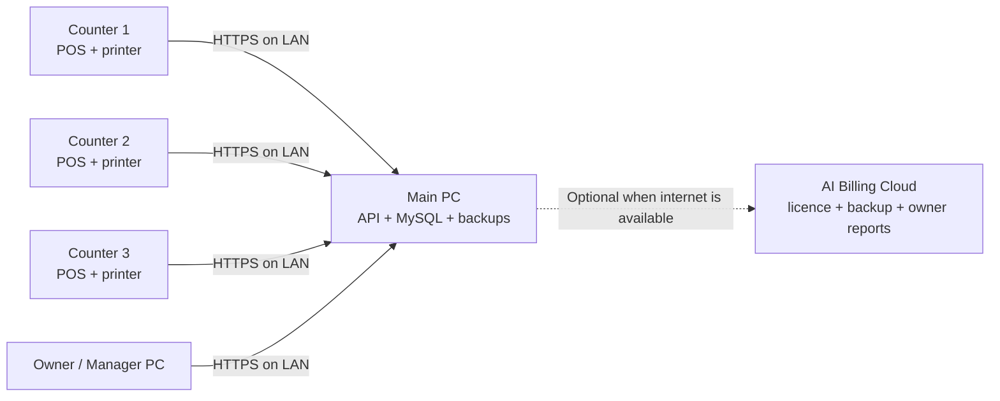

# AI Billing Multi-Counter Offline Plan

## Implementation status

Work started on 16 October 2026.

- [x] Architecture and phased delivery plan
- [x] Counter, device, pairing-request and audit database foundation
- [x] Invoice/payment counter and device references
- [x] Owner/admin Billing Counters management page
- [x] Add, edit, activate and deactivate counter APIs
- [x] Time-limited six-digit pairing-code generation
- [x] Connected-device status and revoke controls
- [x] Pairing request, owner approval and one-time device credential handshake
- [x] Authenticated device heartbeat and last-connected tracking
- [x] Main PC LAN binding, private-address validation and private-network firewall setup
- [x] One installer with Single PC, Main PC and Billing Counter choices
- [x] Counter pairing client, DPAPI-protected credential and connection heartbeat
- [x] Automatic Main PC discovery with manual computer name/IP fallback
- [x] Apply approved device identity to normal API requests with short-lived browser sessions
- [x] Transaction-safe POS submission, retry protection and central invoice allocation
- [x] Cashier shifts and counter reconciliation
- [x] Main PC backup, replacement and guided counter re-pairing workflow

The current build supports a reachable Main PC service, automatic discovery with manual fallback, securely paired Counter PCs, authenticated billing, atomic POS checkout, cashier shift reconciliation and guided Main PC replacement. A real-shop acceptance run and signing with the publisher's trusted certificate remain release activities.

## 1. Goal

Build a supermarket edition of AI Billing in which multiple Windows billing counters use the same products, prices, customers, POS sales and stock while the shop continues working without internet.

The first release will use one **Main PC** as the local server and multiple **Counter PCs** as clients on the same shop LAN. Internet is needed for installation, activation and optional cloud services, but not for daily billing.

## 2. Customer experience

The installer must ask one simple question:

1. **This PC only** — current single-PC offline edition.
2. **Main PC for my shop** — installs the local database, API, backup service and billing app.
3. **Billing counter** — installs the billing app and connects it to the Main PC.

Use familiar terms in the UI:

- Main PC
- Billing Counter
- Counter Name, for example `Counter 1`
- Shop Network
- Connected / Not connected
- Last backup

Avoid exposing database ports, IP addresses and technical server terminology during normal setup.

### Counter connection flow

1. Main PC displays a six-digit pairing code and shop name.
2. Counter PC finds the Main PC automatically on the LAN.
3. Operator confirms the shop name and enters the pairing code.
4. Main PC approves the new counter.
5. Counter downloads settings and opens its login screen.
6. Admin assigns a counter name, cashier permissions and default printer.

Manual Main PC address entry remains available for networks where automatic discovery is blocked.

## 3. Recommended architecture

### Main PC responsibilities

- Store the only authoritative local database.
- Allocate invoice numbers during final billing.
- Process sales and stock changes in database transactions.
- Authenticate users and counters.
- Run scheduled backups and health checks.
- Expose the application only to the shop's private network.
- Optionally synchronize approved summaries or encrypted backups to the cloud.

### Counter PC responsibilities

- Run the POS and other permitted frontend pages.
- Keep only non-authoritative UI cache and printer preferences locally.
- Send completed sales to the Main PC.
- Print through the counter's own thermal printer.
- Clearly show connection state before payment.

The initial version must not maintain separate writable product or stock databases on each counter. That would create conflicts and incorrect stock.

## 4. First-release operating rule

Use **Safe Offline LAN mode**:

- The shop can work without internet.
- The Main PC and router must remain available.
- A counter may prepare or hold a cart if the Main PC disconnects.
- Final payment and invoice creation are disabled until the connection returns.
- The UI must preserve the cart and show: `Main PC connection lost. Your cart is safe. Billing will continue after reconnection.`

True counter-independent billing and later synchronization should be a future phase because it requires conflict resolution, temporary invoice numbers and stock reconciliation.

## 5. Functional scope

### Shared master data

- Products, barcodes, units, HSN/SAC, GST rates and cess
- Sale price, MRP, purchase price and location price
- Categories for POS filtering only; categories remain hidden from printed invoices
- Customers, suppliers and credit balances
- Shop, godown and tax settings
- Staff accounts, roles and permissions

### Shared POS and stock

- Real-time product search and barcode scanning
- Shared available quantity across all counters
- Atomic stock deduction when a sale is finalized
- Prevention or warning according to the configured stock mode
- Held bills visible to authorized counters
- Sales returns linked to the original invoice
- Purchase receiving, stock transfers and adjustments
- Batch and expiry tracking where enabled

### Counter operations

- Counter name and device identity
- Cashier sign-in
- Shift opening balance
- Cash, UPI, card, credit and split payment
- Shift closing with expected and counted cash
- Counter-wise sales, payment and difference report
- Per-counter printer selection and test print
- Reprint permission and audit trail

### Invoice numbering

- Generate the official invoice number only inside the Main PC database transaction.
- Drafts follow the existing `Invoice number for drafts` setting.
- Prevent duplicate numbers with a database unique constraint.
- Allow optional counter prefixes only when the business requests separate series, for example `C1-2026-000123`.
- Preserve financial-year numbering rules.

## 6. Data consistency design

A final POS sale must be processed as one server transaction:

1. Lock or atomically validate the relevant stock rows.
2. Recheck price, tax, permissions and available quantity.
3. Allocate the next invoice number.
4. Create the invoice, items and payments.
5. Write stock ledger entries and update balances.
6. Write the counter, cashier, shift and device audit fields.
7. Commit everything together.

If any step fails, roll back the complete sale. The counter must never print a successful tax invoice before the server confirms the commit.

Use an idempotency key generated by the counter for every payment attempt. Repeating a request after a network timeout must return the already-created invoice rather than create a duplicate sale.

## 7. Database changes

Add or extend tables for:

| Table | Purpose |
|---|---|
| `business_devices` | Approved Main PC and Counter PC identities, status and last seen time |
| `billing_counters` | Counter code, name, location, invoice prefix and default settings |
| `counter_pairing_requests` | Short-lived pairing codes and approval status |
| `cashier_shifts` | Opening cash, start/end time, expected cash, counted cash and variance |
| `held_sales` / existing drafts | Shared held POS carts with ownership and version |
| `invoice_sequences` | Transaction-safe sequence per business, financial year and optional counter |
| `request_idempotency` | Prevent duplicate invoice/payment submission |
| `device_audit_events` | Pairing, revocation, reconnect, print and administrative events |

Extend invoices and payments with `counter_id`, `device_id`, `shift_id` and `cashier_user_id`. Add indexes for business, location, counter, status and date. All business data must continue to be isolated by `business_id`.

## 8. Network and security

- Bind the Main PC service to the private LAN as well as loopback.
- Use an application-generated local certificate or an authenticated encrypted channel.
- Never expose MySQL directly to Counter PCs; only the API may access it.
- Generate a unique device key during pairing and protect it with Windows DPAPI.
- Store only hashes of pairing codes and expire them quickly.
- Require Main PC approval to add, rename or replace a counter.
- Allow an administrator to deactivate a lost or replaced device.
- Rate-limit login and pairing attempts.
- Record device, counter, cashier and time for sensitive actions.
- Add Windows Firewall rules only for the AI Billing API and private networks.
- Reject connections from public network profiles by default.

Cloud activation should license the business and its purchased counter limit. The server signing key remains only on `billing.cloudkart24.com`.

## 9. Main PC reliability

The Main PC is critical shop infrastructure. The installer and UI must therefore provide:

- Start services automatically with Windows.
- A fixed local service name that survives IP changes.
- Main PC health indicator on every counter.
- UPS recommendation during installation.
- Graceful database shutdown.
- Automatic daily backup and backup failure alerts.
- Manual backup to USB.
- Restore validation using the existing `.aibackup` protections.
- A support diagnostic export without customer passwords or licence secrets.
- An assisted `Move Main PC` process that backs up, restores and re-pairs counters.

Recommended deployment: Main PC connected to the router by Ethernet and protected by a UPS. Counter PCs may use Ethernet or reliable shop Wi-Fi.

## 10. Installer changes

### Main PC package

- Reuse the bundled PHP/MySQL runtime.
- Install the server as an auto-start background service.
- Initialize or restore the local business database.
- Configure private-network firewall access.
- Show Main PC name, connection status, pairing code and backup status.
- Include the normal AI Billing desktop interface.

### Counter package

- Do not install MySQL.
- Install the desktop shell, discovery/pairing helper and printer helper.
- Save the approved server identity and device credential securely.
- Provide `Change Main PC` and `Repair connection` tools.

### One installer experience

Prefer one signed `AI-Billing-Setup.exe` containing all three modes. The choice made during setup determines which components are installed. Keep the existing single-PC edition available and unchanged for small shops.

## 11. User interface additions

### Settings > Billing Counters

- Main PC status and shop network name
- Active counters and purchased counter limit
- Counter name, last connected time, app version and printer status
- Approve, rename, deactivate and replace actions
- Generate pairing code
- Clear Tamil/English tooltips for every action

### POS header

- Counter name and cashier name
- Green `Connected to Main PC` indicator
- Red connection-lost banner with retained-cart message
- Current shift state
- Pending/held bill count

### Dashboard and reports

- Today's combined sales
- Sales by counter and cashier
- Payment method by counter
- Open/closed shifts
- Cash difference report
- Device activity and last backup status

## 12. Delivery phases

### Phase 0 — Product and technical decisions

- Confirm supported Windows versions and maximum first-release counters.
- Fix terminology in English and Tamil.
- Decide counter-based pricing and trial limits.
- Write the failure, recovery and Main PC replacement procedures.

**Exit:** approved scope and database/API design.

### Phase 1 — Shared LAN foundation

- Main PC server mode and Counter mode installer choices
- LAN discovery, manual connection and secure pairing
- Device management and cloud counter limits
- Connection status, reconnect and version compatibility checks

**Exit:** two Counter PCs can securely use one test Main PC without internet.

### Phase 2 — Transaction-safe POS

- Central invoice sequence
- Atomic invoice, payment and stock transaction
- Idempotent sale submission
- Shared held bills
- Connection-loss cart preservation
- Per-counter printers

**Exit:** simultaneous billing tests produce no duplicate invoice numbers, sales or negative-stock errors outside configured policy.

### Phase 3 — Supermarket operations

- Cashier shifts and cash reconciliation
- Counter/cashier reports
- Returns and reprint controls
- Purchase receiving, stock adjustments and transfers
- Batch/expiry features where enabled

**Exit:** a complete supermarket day can be opened, operated and closed with auditable totals.

### Phase 4 — Backup, recovery and installer hardening

- Scheduled central backups and USB export
- Main PC restore and replacement workflow
- Counter re-pairing
- Signed installer and update compatibility checks
- Support diagnostics and customer-facing setup guide

**Exit:** clean-PC installation, power-loss recovery and Main PC replacement pass acceptance tests.

### Future phase — Resilient counter sync

- Limited billing when the Main PC is unavailable
- Temporary document identity
- Synchronization queue and conflict handling
- Stock and payment reconciliation UI

This phase should begin only after the centralized LAN edition is stable in real shops.

## 13. Test plan

### Core concurrency tests

- Two to fifteen counters billing simultaneously
- Two counters selling the final available unit
- Repeated submit after timeout
- Main PC restart during a request
- Router disconnect and reconnect with carts open
- Simultaneous product price update and sale
- Financial-year invoice sequence rollover

### Business workflow tests

- Product and price change appears on all counters
- Barcode works at every counter
- GST intra-state and inter-state calculations remain correct
- Cash/UPI/card/split payments reconcile by shift
- Return updates stock exactly once
- Held bill moves between authorized counters
- Draft numbering follows its business setting
- Category remains absent from invoice and print output

### Recovery tests

- Power interruption and automatic service recovery
- Daily and manual backup creation
- Restore to replacement Main PC
- Counter re-pairing after restore
- Disk full, backup failure and database unavailable messages
- Old/new counter app version compatibility

### Customer acceptance setup

Test with at least one real supermarket using three counters, common barcode scanners and the customer's actual 58mm/80mm printers. Run billing during a busy period before general release.

## 14. Commercial packaging

| Edition | Typical customer | Included devices |
|---|---|---:|
| Single PC | Small shop | 1 PC |
| Multi-Counter | Mini supermarket | 1 Main PC + 2 counters |
| Multi-Counter Plus | Supermarket | 1 Main PC + 5 counters |
| Enterprise / Multi-Shop | Larger chains | Custom counters and locations |

Offer paid add-ons for extra counters, installation, data import, printer setup, cloud backup, priority support and annual maintenance. Device replacement should be manageable from the AI Billing cloud admin without revealing activation keys.

## 15. Support and onboarding

Provide short Tamil and English guides for:

- Which PC should be the Main PC?
- How to connect a new billing counter
- How to open and close a cashier shift
- What to do when `Main PC not connected` appears
- How to test a thermal printer
- How to back up to a pen drive
- How to replace or move the Main PC

Add visual tooltips and a first-day checklist inside the application. Use shop-owner language and screenshots rather than database or networking terms.

## 16. Release recommendation

Release the centralized LAN edition first with a supported limit of **five simultaneous billing counters**. Use Safe Offline LAN mode, transaction-safe stock, central invoice numbering, cashier shifts, per-counter printing and central backup. Pilot it with one supermarket before selling it broadly, then increase the tested counter limit and consider independent-counter synchronization.

